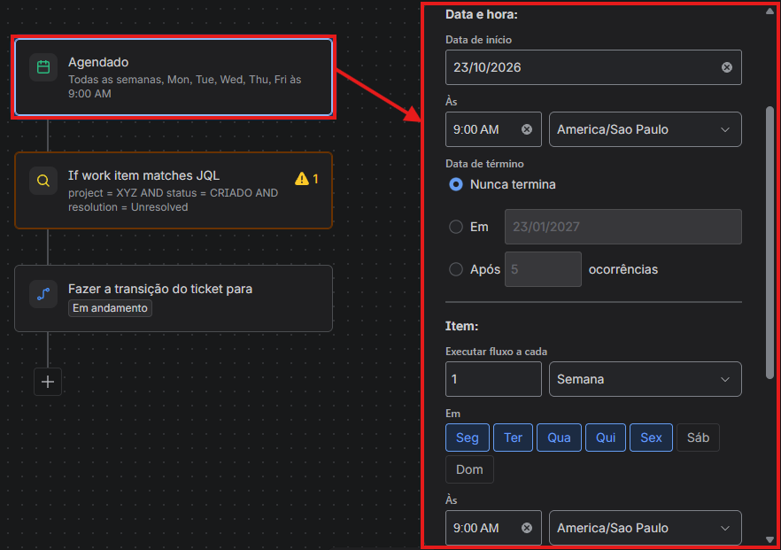
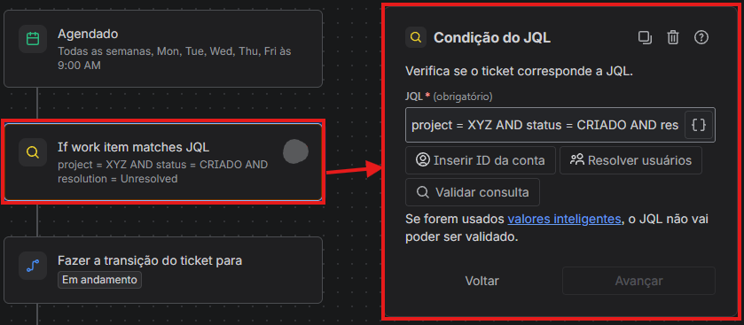
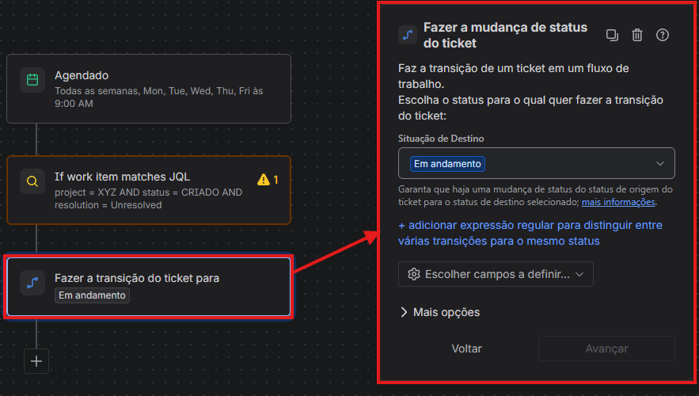

# Automação: Primeiro Atendimento

## 1. Objetivo

Automatizar a transição dos chamados para o status que inicia a contagem do SLA de primeiro atendimento, respeitando o horário de funcionamento das equipes responsáveis pelo atendimento.

A solução foi concebida para garantir maior consistência na contabilização dos prazos, independentemente do momento em que uma solicitação fosse registrada na plataforma.

## 2. Cenário operacional

A plataforma de solicitações permanecia disponível 24 horas por dia, permitindo que os usuários registrassem chamados a qualquer momento, inclusive durante a madrugada, aos finais de semana e em feriados.

Entretanto, a disponibilidade da plataforma não significava que as equipes de atendimento estivessem operando continuamente.

A organização também possuía atividades aos finais de semana, especialmente em função de shows e eventos esportivos que costumam ocorrer nesses momentos. Contudo, as equipes responsáveis pelo atendimento centralizado e pelos serviços compartilhados não necessariamente acompanhavam essa mesma jornada operacional.

Essa diferença entre o horário de registro das solicitações e a disponibilidade das equipes poderia gerar inconsistências na interpretação dos prazos de atendimento.

## 3. Problema identificado

Sem uma regra adequada de transição entre os status, um chamado registrado durante a madrugada poderia iniciar a contagem do SLA antes do início da jornada da equipe responsável.

Uma situação semelhante ocorreria com solicitações abertas durante o fim de semana, mesmo quando o atendimento centralizado só fosse retomado no próximo dia útil.

O objetivo, portanto, era evitar que o tempo transcorrido fora do período de atendimento fosse contabilizado indevidamente como tempo de resposta da equipe.

## 4. Estratégia adotada

A solução proposta utilizava uma automação para controlar a transição dos chamados entre dois momentos do fluxo.

### Status inicial: Criado

Quando uma solicitação fosse registrada, permaneceria inicialmente no status `Criado`.

Nesse estado, a contagem do SLA de primeiro atendimento não deveria começar.

### Transição para o atendimento

A partir das 9h de um dia útil, uma automação movimentaria o chamado para o status configurado para iniciar a contagem do SLA de primeiro atendimento.

Dessa forma, a contabilização seria iniciada de acordo com o horário definido para o início da jornada de atendimento, em vez de ocorrer necessariamente no momento da criação da solicitação.

## 5. Jornada de atendimento considerada

Para o desenho da solução, foi considerada a seguinte jornada:

- Início: 9h;
- Encerramento: 18h;
- Dias de atendimento: dias úteis.

Nesse modelo, as solicitações registradas fora do período de atendimento aguardariam a transição correspondente ao próximo período de funcionamento.

### Exemplos de comportamento esperado

| Momento de abertura | Início esperado da contagem do SLA |
|---|---|
| Segunda-feira, às 8h | Segunda-feira, às 9h |
| Segunda-feira, às 14h | Conforme o fluxo e a configuração do SLA aplicados ao chamado |
| Sábado, às 11h | Segunda-feira, às 9h |
| Domingo, às 23h | Segunda-feira, às 9h |
| Segunda-feira, às 3h | Segunda-feira, às 9h |

Os exemplos pressupõem que o chamado permaneça no status inicial até a próxima transição prevista e que não haja feriados ou exceções de calendário alterando a jornada considerada.

## 6. Benefícios esperados

A abordagem foi concebida para proporcionar:

- **Padronização da contagem:** os chamados iniciariam a contabilização do primeiro atendimento conforme uma referência de horário comum.
- **Coerência operacional:** o registro de uma solicitação fora da jornada não provocaria, por si só, o início antecipado da contagem.
- **Previsibilidade:** usuários e equipes teriam uma referência mais consistente para compreender o início do prazo de atendimento.
- **Alinhamento entre processos e indicadores:** o comportamento do fluxo seria relacionado à jornada efetiva das equipes responsáveis pelo atendimento.

## 7. Pontos técnicos de validação

A implementação de uma solução semelhante exige verificar:

- Se o status inicial está configurado para não iniciar a contagem do SLA;
- Se a transição para o status de atendimento ocorre no horário previsto;
- Se a automação considera corretamente dias úteis, finais de semana e feriados;
- Se os calendários e fusos horários utilizados estão alinhados;
- Se a configuração do SLA corresponde à jornada definida;
- Se chamados criados durante o expediente, fora do expediente e nos finais de semana apresentam o comportamento esperado.

Também é importante validar o comportamento da regra quando um chamado permanece no status inicial por mais de um dia útil.

## 8. Limitações

Este documento descreve a finalidade operacional e a estratégia geral da automação.

Os detalhes do gatilho, das condições, da programação e das ações técnicas devem ser confirmados na configuração da regra antes de uma eventual reprodução em outro ambiente.

A descrição não representa uma exportação da automação original nem comprova sua configuração atual.

## 9. Confidencialidade

A documentação descreve o problema, a estratégia e os resultados esperados sem divulgar nomes de projetos, identificadores de chamados, usuários ou configurações internas.

O objetivo é demonstrar conhecimentos de automação, gestão de SLAs e desenho de processos organizacionais sem expor informações proprietárias.

## 10. Observações operacionais

### 10.1. A automação não substitui a triagem manual

A automação foi concebida como um mecanismo de padronização do fluxo, não como uma obrigação de aguardar passivamente a transição automática.

Os atendentes permanecem livres para realizar a triagem manual e movimentar uma solicitação conforme a necessidade operacional.

Essa flexibilidade é importante porque o tempo de resposta pode ser determinante para o sucesso de uma operação, especialmente em solicitações críticas.

Por exemplo, um chamado registrado às 10h de uma segunda-feira poderia permanecer no status inicial até a próxima transição automática prevista para as 9h do dia útil seguinte. Entretanto, se a situação exigir uma atuação antecipada, o atendente poderá realizar a triagem e dar andamento ao chamado antes desse momento, conforme os procedimentos e as permissões definidos para o processo.

Caso não ocorra intervenção manual, a automação funciona como mecanismo de continuidade, movimentando o chamado de acordo com as regras configuradas.

### 10.2. Possibilidade de exceções por prioridade

A automação também pode ser configurada para tratar solicitações de maneira diferente conforme sua prioridade ou criticidade.

Uma possibilidade é aplicar a transição automática apenas a chamados de prioridades mais baixas, permitindo que solicitações críticas sigam um fluxo diferenciado.

Essa abordagem pode evitar que demandas urgentes aguardem uma transição programada quando exigirem atuação imediata.

Os critérios de prioridade, as condições de exceção e os comportamentos esperados devem ser definidos durante a implementação, considerando os riscos e as necessidades de cada processo.

### 10.3. Flexibilidade de implementação

A regra descrita representa uma estratégia possível, não uma configuração universal.

Cada organização pode adaptar a automação de acordo com:

- A criticidade das solicitações;
- Os horários de funcionamento das equipes;
- Os calendários de atendimento;
- Os procedimentos de triagem;
- Os critérios de prioridade;
- As regras de início e contagem dos SLAs.

O objetivo é estabelecer um comportamento padrão sem impedir a intervenção humana quando o contexto operacional exigir uma decisão diferente.

A configuração final deve ser validada para garantir que as transições automáticas, as exceções e os SLAs funcionem de maneira coerente.

## 11. Implementação demonstrativa

A implementação abaixo foi criada em um ambiente de testes do Jira para demonstrar a estratégia de transição automática dos chamados.

A regra combina um agendamento, uma condição JQL e uma ação de transição de status.

### 11.1. Condição de seleção dos chamados

A condição JQL seleciona chamados do projeto de teste que estejam no status `CRIADO` e sem resolução.

### 11.2. Agendamento da automação

A regra está configurada para execução às 9h, de segunda a sexta-feira, utilizando o fuso horário `America/Sao_Paulo`.

### 11.3. Ação de transição

Após a seleção dos chamados elegíveis, a regra executa a transição para o status `Em atendimento`.

### 11.4. Observações técnicas

Esta implementação demonstra uma estratégia de movimentação automática de chamados em um ambiente de testes.

A execução programada, a condição JQL e a transição de status precisam funcionar em conjunto para produzir o comportamento esperado.

A configuração exibida não comprova, isoladamente, que o SLA começa a contar no momento correto. Esse comportamento depende também da configuração do indicador de SLA e deve ser validado por meio de testes.

A regra apresentada não inclui condições específicas de prioridade. O tratamento de chamados críticos pode exigir exceções adicionais, conforme os requisitos do processo.

As capturas foram produzidas em um ambiente de testes e não devem ser interpretadas como uma reprodução integral da configuração do ambiente profissional original.
