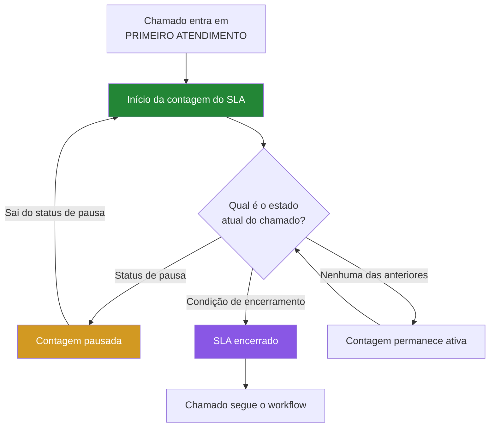

# ⏱️ SLA de Primeiro Atendimento

> Documentação de um SLA configurado no **Jira Service Management** para monitorar o tempo até a primeira atuação da equipe sobre um chamado.

---

## 📑 Sumário

1. [Visão geral](#1-visão-geral)
2. [Parâmetros de configuração](#2-parâmetros-de-configuração)
3. [Aplicabilidade](#3-aplicabilidade)
4. [Ciclo de vida do SLA](#4-ciclo-de-vida-do-sla)
5. [Decisões técnicas](#5-decisões-técnicas)
6. [Relação com o processo operacional](#6-relação-com-o-processo-operacional)
7. [Resumo técnico](#7-resumo-técnico)
8. [Considerações finais](#8-considerações-finais)

---

## 1. Visão geral

O **SLA de Primeiro Atendimento** monitora o tempo que a equipe leva para iniciar a primeira atuação sobre um chamado.

Seu objetivo é garantir que as solicitações sejam atendidas dentro de um prazo previsível, respeitando o calendário de trabalho das áreas responsáveis e desconsiderando os períodos em que o chamado depende de aprovações, agendamentos ou terceiros.

---

## 2. Parâmetros de configuração

| Parâmetro | Configuração |
|---|---|
| **Calendário (com meta)** | Calendário Áreas Centrais |
| **Prioridade Urgente** | 43 horas |
| **Prioridade Padrão** | 72 horas |
| **Demais prioridades** | Sem meta — 24/7 Calendário (Padrão) |
| **Demais itens** | Sem meta — 24/7 Calendário (Padrão) |
| **Status de início** | `PRIMEIRO ATENDIMENTO` |
| **Condições de pausa** | 5 status configurados |
| **Condições de encerramento** | 6 condições configuradas |
| **Formato de exibição** | Foco na data de entrega |

---

## 3. Aplicabilidade

O SLA é aplicado somente aos tipos de solicitação definidos para esse processo.

No ambiente original, a aplicabilidade é determinada por uma condição **JQL** que seleciona os tipos de solicitação e, em seguida, aplica metas diferentes conforme a prioridade do chamado. Para preservar informações internas, os tipos de solicitação e demais identificadores específicos não são reproduzidos nesta documentação.

### Metas por prioridade

| Prioridade | Calendário | Meta de tempo |
|---|---|---|
| 🔺 Urgente | Calendário Áreas Centrais | **43h** |
| 🟰 Padrão | Calendário Áreas Centrais | **72h** |
| Todas as prioridades restantes | 24/7 Calendário (Padrão) | Sem meta |
| Todos os itens remanescentes | 24/7 Calendário (Padrão) | Sem meta |

> [!TIP]
> Os itens são verificados **de cima para baixo**, e a meta de tempo é atribuída com base na **primeira instrução JQL correspondente**. Chamados fora do escopo da condição caem na regra final, **sem meta**.

---

## 4. Ciclo de vida do SLA

### 4.1 Início da contagem

A contagem começa quando o chamado entra no status:

`PRIMEIRO ATENDIMENTO`

### 4.2 Fluxo operacional

### 4.3 Condições de pausa

A contagem é **pausada** enquanto o chamado permanecer em um dos status abaixo:

| Tipo | Condição |
|---|---|
| Status | `ATENDIMENTO AGENDADO` |
| Status | `CRIADO` |
| Status | `Pendente Aprovação` |
| Status | `Pendente Outra Área` |
| Status | `Pendente Terceirizado` |

Nesses status, o chamado não depende da ação imediata da equipe de atendimento, portanto o tempo não é contabilizado contra o SLA.

### 4.4 Condições de encerramento

| Tipo | Condição |
|---|---|
| Resolução | Resolução definida |
| Status inserido | `AGUARDANDO DEMANDANTE` |
| Status inserido | `Cancelado` |
| Status inserido | `Concluído` |
| Status inserido | `NÃO APROVADO` |
| Status inserido | `RETORNO 1` |

A contagem é encerrada quando uma resolução é definida, quando o chamado é finalizado (concluído, cancelado ou não aprovado) ou quando ele avança para uma etapa em que a espera passa a ser do demandante ou de um retorno.

---

## 5. Decisões técnicas

### 5.1 Calendários distintos por finalidade

As metas de **Urgente** (43h) e **Padrão** (72h) utilizam o **Calendário Áreas Centrais**, que representa o período efetivo de atuação das equipes. Já os itens **sem meta** utilizam o calendário padrão 24/7, pois não há prazo a ser cumprido.

### 5.2 Pausas por dependências externas

Foram configurados cinco status de pausa para que dependências fora do controle imediato da equipe (aprovações, outras áreas, terceiros e agendamentos) não penalizem o indicador.

### 5.3 Encerramento por mudança de responsabilidade

O SLA é encerrado não apenas por conclusão, mas também quando a responsabilidade pelo próximo passo muda. Ao entrar em `AGUARDANDO DEMANDANTE`, por exemplo, a espera passa a ser do solicitante, e não mais da equipe.

### 5.4 Exibição focada na data de entrega

O formato de exibição prioriza a **data e hora de vencimento**, facilitando a leitura pelos analistas. O indicador aparece, por exemplo, como horário restante, em destaque quando o prazo está próximo de estourar, ou como data de entrega com ícone de sucesso quando cumprido.

---

## 6. Relação com o processo operacional

O SLA de Primeiro Atendimento é o ponto de partida dos indicadores de atendimento da equipe: ele mede quanto tempo o chamado leva para receber a primeira atuação.

Seu encerramento por `AGUARDANDO DEMANDANTE` o conecta ao [SLA de Retorno do Demandante](./SLA-Retorno-do-Demandante.md), que inicia justamente nesse status. Já a transição para `RETORNO 1` dá sequência ao acompanhamento das interações posteriores.

Essa separação permite distinguir:

- ⚙️ Tempo até a primeira atuação da equipe
- ⏳ Tempo aguardando o demandante
- 🔁 Tempo de execução de retornos e revisões

---

## 7. Resumo técnico

| Elemento | Regra |
|---|---|
| **Início** | Entrada em `PRIMEIRO ATENDIMENTO` |
| **Pausa** | `ATENDIMENTO AGENDADO`, `CRIADO`, `Pendente Aprovação`, `Pendente Outra Área`, `Pendente Terceirizado` |
| **Encerramento** | Resolução definida ou entrada em `AGUARDANDO DEMANDANTE`, `Cancelado`, `Concluído`, `NÃO APROVADO` ou `RETORNO 1` |
| **Meta Urgente** | 43 horas |
| **Meta Padrão** | 72 horas |
| **Calendário das metas** | Calendário Áreas Centrais |
| **Demais casos** | Sem meta — 24/7 Calendário (Padrão) |

---

## 8. Considerações finais

O SLA de Primeiro Atendimento estabelece um mecanismo objetivo para acompanhar o tempo até a primeira atuação da equipe sobre cada chamado.

A combinação de metas por prioridade, calendário específico, pausas por dependências externas e múltiplas condições de encerramento permite medir apenas o tempo que realmente depende da equipe, tornando o indicador mais justo e útil para a gestão do atendimento.
