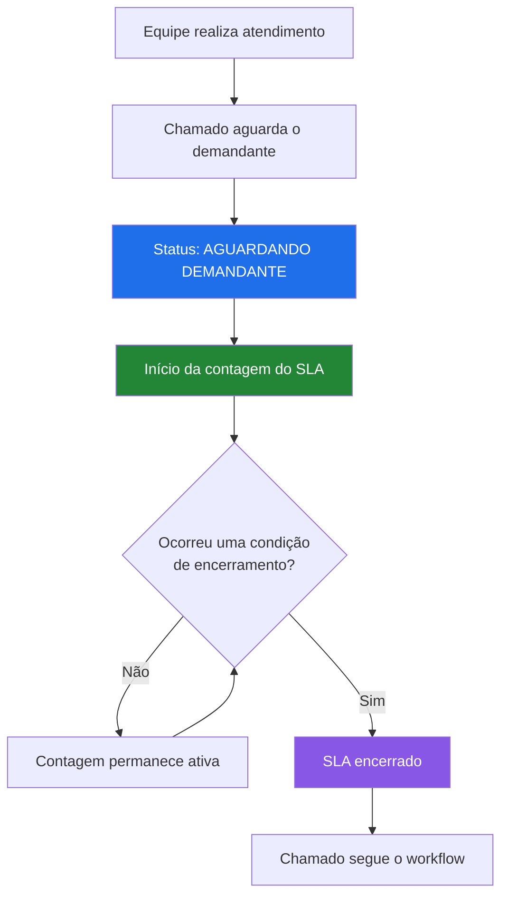

# ⏱️ SLA de Retorno do Demandante

> Documentação de um SLA configurado no **Jira Service Management** para monitorar chamados que aguardam uma manifestação do solicitante.

---

## 📑 Sumário

1. [Visão geral](#1-visão-geral)
2. [Parâmetros de configuração](#2-parâmetros-de-configuração)
3. [Aplicabilidade](#3-aplicabilidade)
4. [Ciclo de vida do SLA](#4-ciclo-de-vida-do-sla)
5. [Decisões técnicas](#5-decisões-técnicas)
6. [Relação com o processo operacional](#6-relação-com-o-processo-operacional)
7. [Resumo técnico](#7-resumo-técnico)
8. [Considerações finais](#8-considerações-finais)

---

## 1. Visão geral

O **SLA de Retorno do Demandante** monitora o período em que um chamado permanece aguardando uma resposta do solicitante.

Seu objetivo é estabelecer um limite de acompanhamento para solicitações que dependem de informações ou de uma manifestação do demandante, permitindo identificar pendências prolongadas e dar maior previsibilidade ao processo de atendimento.

---

## 2. Parâmetros de configuração

| Parâmetro | Configuração |
|---|---|
| **Calendário** | 24/7 — Calendário padrão |
| **Prioridade Urgente** | 360 horas (15 dias) |
| **Prioridade Padrão** | 360 horas (15 dias) |
| **Demais prioridades** | Sem meta |
| **Status de início** | `AGUARDANDO DEMANDANTE` |
| **Condições de pausa** | Nenhuma |
| **Formato de exibição** | Data e hora de vencimento |

> [!NOTE]
> A meta de 15 dias é uma **premissa hipotética** adotada para este case de portfólio. A configuração histórica consultada apresenta 720 horas. O valor documentado aqui foi ajustado para o cenário hipotético solicitado.

---

## 3. Aplicabilidade

O SLA é aplicado somente aos tipos de solicitação definidos para esse processo.

No ambiente original, a aplicabilidade é determinada por uma condição **JQL**. Para preservar informações internas, os tipos de solicitação e demais identificadores específicos não são reproduzidos nesta documentação.

> [!TIP]
> A configuração de objetivos do Jira avalia as condições **na ordem apresentada, de cima para baixo**. A primeira condição correspondente determina a meta aplicável ao chamado.

---

## 4. Ciclo de vida do SLA

### 4.1 Início da contagem

A contagem começa quando o chamado entra no status:

`AGUARDANDO DEMANDANTE`

Esse status indica que a continuidade do atendimento depende de uma manifestação do solicitante.

### 4.2 Fluxo operacional

### 4.3 Condições de pausa

Não existem condições de pausa configuradas para este SLA.

Após o início da contagem, o tempo permanece ativo até que uma das condições de encerramento seja atendida.

### 4.4 Condições de encerramento

| Tipo | Condição |
|---|---|
| Comentário | Comentário do cliente |
| Resolução | Resolução definida |
| Status | `Cancelado` |
| Status | `Concluído` |
| Status | `RETORNO 1` |
| Status | `RETORNO 2` |
| Status | `RETORNO 3` |
| Status | `RETORNO 4` |

A contagem é encerrada quando o solicitante se manifesta, quando uma resolução é definida ou quando o chamado avança para uma das etapas de retorno previstas.

---

## 5. Decisões técnicas

### 5.1 Calendário 24/7

Foi adotado o calendário padrão 24/7. Nesse cenário hipotético, a meta de 360 horas equivale a **15 dias corridos**.

### 5.2 Ausência de pausas

A configuração não prevê pausas intermediárias. A partir da entrada em `AGUARDANDO DEMANDANTE`, o tempo continua sendo contabilizado até que uma condição de encerramento seja atendida.

### 5.3 Múltiplas condições de encerramento

O SLA contempla diferentes eventos de encerramento para refletir as possibilidades de evolução do chamado no workflow.

Além do comentário do cliente e da definição de resolução, as transições para os status de retorno da equipe também encerram este ciclo de SLA.

---

## 6. Relação com o processo operacional

O SLA de Retorno do Demandante complementa os indicadores de atendimento da equipe.

Enquanto o SLA de **Primeiro Atendimento** acompanha a primeira atuação e os SLAs de **Retorno** acompanham as interações posteriores, este indicador monitora especificamente o período em que o processo depende de uma manifestação do solicitante.

Essa separação permite distinguir:

- ⚙️ Tempo de atuação da equipe
- ⏳ Tempo aguardando o demandante
- 🔁 Tempo de execução de retornos e revisões

---

## 7. Resumo técnico

| Elemento | Regra |
|---|---|
| **Início** | Entrada em `AGUARDANDO DEMANDANTE` |
| **Pausa** | Nenhuma |
| **Encerramento** | Comentário do cliente, resolução definida ou transições configuradas |
| **Meta Urgente** | 360 horas |
| **Meta Padrão** | 360 horas |
| **Calendário** | 24/7 |

---

## 8. Considerações finais

O SLA de Retorno do Demandante estabelece um mecanismo objetivo para acompanhar chamados que dependem de uma manifestação do solicitante.

A combinação de uma meta temporal, um status específico de início e múltiplas condições de encerramento permite representar esse período diretamente no ciclo de vida do chamado.
