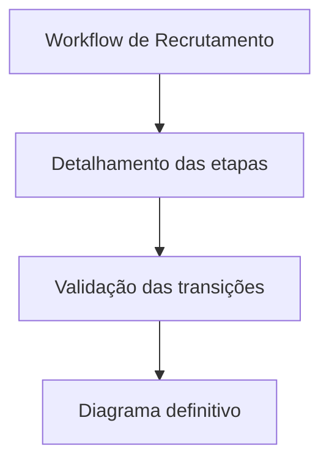
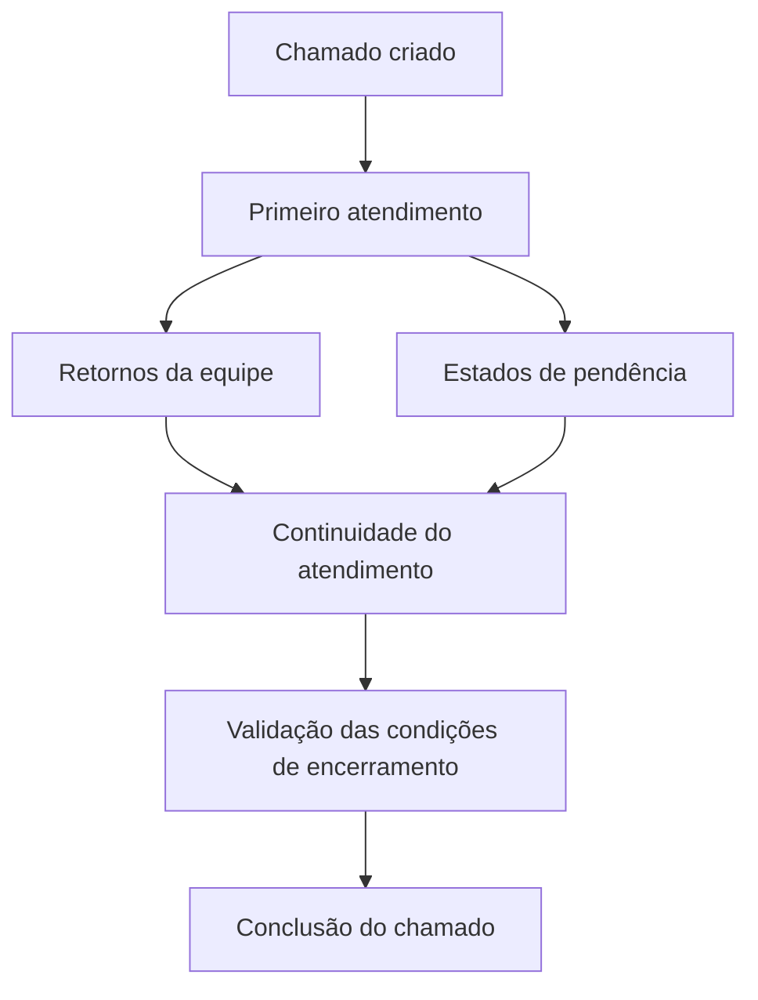

# Workflows — Fluxos de Trabalho

Documentação dos fluxos de trabalho implementados no Jira Service Management, contemplando a organização dos processos, estados dos chamados, transições e integração com os mecanismos de atendimento.

---

## 📑 Sumário

1. [Visão geral](#1-visão-geral)
2. [Arquitetura dos workflows](#2-arquitetura-dos-workflows)
3. [Workflow de Recrutamento](#3-workflow-de-recrutamento)
4. [Workflow de TI / Administrativo](#4-workflow-de-ti--administrativo)
5. [Workflow Financeiro](#5-workflow-financeiro)
6. [Integração com SLAs](#6-integração-com-slas)
7. [Integração com automações](#7-integração-com-automações)
8. [Análise técnica e decisões de implementação](#8-análise-técnica-e-decisões-de-implementação)
9. [Considerações finais](#9-considerações-finais)

---

## 1. Visão geral

Os workflows são responsáveis por controlar o ciclo de vida das solicitações dentro do Jira Service Management.

Eles determinam os estados que um chamado pode assumir, as transições disponíveis entre esses estados e as condições necessárias para que uma solicitação avance no processo.

Nesta implementação, foram estruturados fluxos específicos para diferentes áreas de negócio, respeitando as particularidades de cada operação.

### Objetivos da implementação

- Organizar o ciclo de vida das solicitações.
- Padronizar os estados e as transições dos chamados.
- Representar as etapas operacionais de cada área.
- Controlar situações de aprovação, pendência, atendimento e conclusão.
- Integrar os estados dos chamados aos mecanismos de SLA.
- Permitir maior rastreabilidade das etapas de atendimento.

---

## 2. Arquitetura dos workflows

A implementação contempla três fluxos de trabalho:

| Workflow | Área de aplicação | Finalidade |
|---|---|---|
| Recrutamento | Recursos Humanos | Gerenciar as etapas do processo de recrutamento. |
| TI / Administrativo | Tecnologia da Informação e Administração | Controlar solicitações e atendimentos internos. |
| Financeiro | Financeiro | Organizar as etapas das solicitações financeiras. |

Cada workflow possui estados e transições próprios, de acordo com a natureza do processo atendido.

### 2.1 Elementos de um workflow

A análise técnica dos fluxos será organizada considerando os seguintes elementos:

| Elemento | Descrição |
|---|---|
| Status inicial | Estado em que a solicitação entra no processo. |
| Status intermediários | Etapas pelas quais o chamado pode passar. |
| Transições | Movimentações permitidas entre os estados. |
| Aprovações | Etapas que dependem de validação ou autorização. |
| Pendências | Estados em que o processo aguarda alguma ação ou dependência. |
| Status finais | Estados que representam a conclusão ou o encerramento do processo. |

### 2.2 Representação visual

Os workflows serão documentados por meio de diagramas Mermaid.

Essa abordagem permite representar visualmente os estados e as transições sem depender de capturas de tela do ambiente corporativo.

Os diagramas serão construídos após a validação das regras de cada fluxo.

---

## 3. Workflow de Recrutamento

### 3.1 Objetivo

O workflow de Recrutamento organiza as etapas de uma solicitação relacionada ao processo seletivo, desde sua criação até a conclusão ou interrupção do processo.

A estrutura contempla etapas de aprovação, briefing, divulgação da vaga, triagem, entrevistas, validação do candidato e formalização da contratação.

### 3.2 Etapas identificadas

A documentação original apresenta os seguintes estados:

| Etapa | Status |
|---|---|
| Criação | `CRIADO` |
| Aprovação | `APROVAÇÃO FINANCEIRO` |
| Planejamento | `BRIEFING` |
| Divulgação | `POSTANDO VAGA` |
| Seleção | `TRIAGEM DE CURRÍCULO` |
| Entrevistas | `AGENDAMENTO ENTREVISTA` |
| Entrevista | `ENTREVISTA RH` |
| Entrevista | `ENTREVISTA GESTOR` |
| Validação | `VALIDAÇÃO DO GESTOR` |
| Aprovação | `APROVAÇÃO DO CANDIDATO` |
| Formalização | `ALINHAR DATA DE INÍCIO` |
| Proposta | `FORMALIZAÇÃO PROPOSTA` |
| Comunicação | `E-MAIL BOAS-VINDAS` |
| Documentação | `PENDENTE DOCUMENTAÇÃO` |
| Encaminhamento | `ACIONAR ÁREAS CENTRAIS` |
| Contrato | `ENVIO DE CONTRATO` |
| Assinatura | `ASSINATURA CONTRATO` |

Também são identificados estados de encerramento ou interrupção:

- `NÃO APROVADO`
- `SEM RESPOSTA`
- `CANCELADO`
- `CONCLUÍDO`

### 3.3 Fluxo de trabalho

O diagrama será elaborado após a validação das transições e dos caminhos alternativos do processo.

### 3.4 Regras operacionais

A análise desta seção deverá identificar:

- Condições para avanço entre as etapas.
- Dependências de aprovação.
- Tratamento de candidatos não aprovados.
- Situações de ausência de resposta.
- Condições de cancelamento.
- Critérios para conclusão do processo.

---

## 4. Workflow de TI / Administrativo

### 4.1 Objetivo

O workflow de TI / Administrativo organiza o ciclo de vida dos chamados internos, contemplando a entrada das solicitações, o primeiro atendimento, os retornos da equipe, as pendências e o encerramento.

Esse fluxo possui integração direta com a estrutura de SLAs documentada neste projeto.

### 4.2 Status identificados

A documentação original apresenta os seguintes estados:

| Categoria | Status |
|---|---|
| Entrada | `CRIADO` |
| Atendimento | `PRIMEIRO ATENDIMENTO` |
| Retorno | `RETORNO 1` |
| Retorno | `RETORNO 2` |
| Retorno | `RETORNO 3` |
| Retorno | `RETORNO 4` |
| Pendência | `PENDENTE APROVAÇÃO` |
| Pendência | `AGUARDANDO DEMANDANTE` |
| Pendência | `PENDENTE OUTRA ÁREA` |
| Pendência | `PENDENTE TERCEIRIZADO` |
| Agendamento | `ATENDIMENTO AGENDADO` |
| Encerramento | `NÃO APROVADO` |
| Encerramento | `CONCLUÍDO` |
| Encerramento | `CANCELADO` |
| Encerramento | `SEM RESPOSTA` |

### 4.3 Organização do fluxo

O workflow contempla três grupos principais de estados:

**Atendimento**
- Criação da solicitação.
- Primeiro atendimento.
- Etapas de retorno da equipe.

**Pendências**
- Aprovação.
- Aguardando manifestação do demandante.
- Dependência de outra área.
- Dependência de terceiro.
- Atendimento agendado.

**Encerramento**
- Não aprovado.
- Concluído.
- Cancelado.
- Sem resposta.

### 4.4 Diagrama do workflow

O diagrama definitivo será elaborado após a validação das transições e dos caminhos permitidos entre os estados.

> Diagrama conceitual. As transições efetivas serão documentadas após a análise detalhada do workflow original.

---

## 5. Workflow Financeiro

### 5.1 Objetivo

O workflow Financeiro representa o fluxo de trabalho utilizado para organizar solicitações relacionadas à área financeira.

Sua documentação deverá contemplar os estados, as transições, as etapas de aprovação e os critérios de conclusão específicos desse processo.

### 5.2 Estrutura do fluxo

A documentação original identifica a existência de um workflow dedicado ao Financeiro.

Os detalhes de seus estados e transições serão registrados após a análise da configuração correspondente.

### 5.3 Diagrama do workflow

O diagrama será elaborado após a identificação e validação dos estados e das transições do processo.

---

## 6. Integração com SLAs

Os workflows possuem relação direta com a configuração dos Acordos de Nível de Serviço.

Os estados dos chamados são utilizados como condições para iniciar, pausar ou encerrar a contagem dos SLAs.

### 6.1 Relação entre status e SLAs

| SLA | Evento associado ao workflow |
|---|---|
| Primeiro Atendimento | Entrada em `PRIMEIRO ATENDIMENTO` |
| Retorno do Demandante | Entrada em `AGUARDANDO DEMANDANTE` |
| Primeiro Retorno | Entrada em `RETORNO 1` |
| Segundo Retorno | Entrada em `RETORNO 2` |
| Terceiro Retorno | Entrada em `RETORNO 3` |
| Quarto Retorno | Entrada em `RETORNO 4` |

### 6.2 Importância da integração

A utilização dos estados do workflow como condições dos SLAs permite conectar o andamento do chamado aos indicadores de atendimento.

Dessa forma, as transições não representam apenas mudanças visuais de status: elas também podem controlar eventos importantes para o monitoramento operacional.

---

## 7. Integração com automações

As automações complementam os workflows ao executar transições específicas conforme regras previamente definidas.

Entre as automações documentadas neste projeto estão:

| Automação | Finalidade |
|---|---|
| Primeiro Atendimento | Movimentar chamados para o status que inicia o SLA de primeiro atendimento. |
| Sem Resposta do Demandante | Movimentar chamados sem resposta após 30 dias para `SEM RESPOSTA`. |

A documentação detalhada das regras e condições dessas automações está disponível no case de automações.

---

## 8. Análise técnica e decisões de implementação

A documentação dos workflows será desenvolvida considerando os seguintes aspectos:

### 8.1 Organização dos processos

Avaliação da estrutura dos estados e das transições de cada área.

### 8.2 Controle de etapas

Identificação de estados que representam atendimento, aprovação, dependência externa, retorno e encerramento.

### 8.3 Integração operacional

Análise da relação entre workflows, SLAs, automações e filas de atendimento.

### 8.4 Rastreabilidade

Avaliação de como os estados permitem identificar a etapa atual de uma solicitação e acompanhar sua evolução.

### 8.5 Padronização

Identificação de oportunidades para tornar os processos mais claros, consistentes e previsíveis.

---

## 9. Considerações finais

Os workflows representam a estrutura operacional que conecta as solicitações às etapas necessárias para seu tratamento.

A implementação de fluxos específicos para diferentes áreas permite representar as particularidades de cada processo dentro do Jira Service Management.

Quando integrados aos SLAs, às automações e às filas operacionais, os workflows passam a desempenhar um papel central no controle do ciclo de vida dos chamados.

**Tecnologias e conceitos:** Jira Service Management · Workflow Management · ITSM · Gestão de Processos · SLA Management · Automação · Gestão de Serviços de TI.
