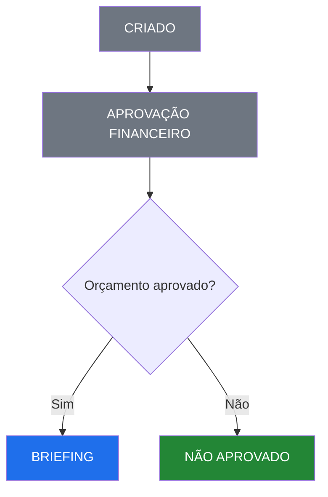
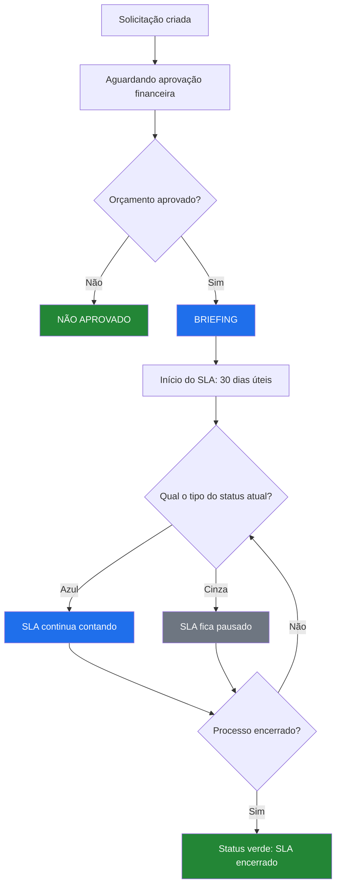

# Workflow de Recrutamento e Seleção

> Documentação do fluxo de recrutamento e seleção implementado no Jira Service Management, desde a abertura da solicitação e aprovação orçamentária até a formalização da contratação ou o encerramento antecipado do processo.

---

## 📑 Sumário

1. [Visão geral](#1-visão-geral)
2. [Objetivos e governança do processo](#2-objetivos-e-governança-do-processo)
3. [Classificação visual dos status](#3-classificação-visual-dos-status)
4. [Ciclo de vida do chamado](#4-ciclo-de-vida-do-chamado)
5. [Etapas do workflow](#5-etapas-do-workflow)
6. [Aprovação orçamentária e controle financeiro](#6-aprovação-orçamentária-e-controle-financeiro)
7. [SLA do processo seletivo](#7-sla-do-processo-seletivo)
8. [Interrupção e encerramento antecipado](#8-interrupção-e-encerramento-antecipado)
9. [Diagrama do workflow](#9-diagrama-do-workflow)
10. [Regras operacionais e pontos de controle](#10-regras-operacionais-e-pontos-de-controle)
11. [Considerações finais](#11-considerações-finais)

---

## 1. Visão geral

O Workflow de Recrutamento e Seleção organiza o ciclo de vida de uma solicitação de contratação dentro do Jira Service Management.

O fluxo representa as etapas necessárias para conduzir um processo seletivo, incluindo:

- Abertura da solicitação.
- Aprovação orçamentária pelo Financeiro.
- Briefing e divulgação da vaga.
- Triagem de currículos.
- Agendamento e realização de entrevistas.
- Avaliação e aprovação do candidato.
- Alinhamento da data de início.
- Formalização da proposta.
- Comunicação de boas-vindas.
- Recebimento e validação da documentação.
- Acionamento das áreas centrais.
- Envio e assinatura do contrato.

O workflow também contempla caminhos de interrupção e encerramento, permitindo registrar processos não aprovados, cancelados ou sem resposta.

A estrutura foi desenhada para representar o processo de contratação como um fluxo controlado, com etapas identificáveis, dependências e acompanhamento de prazo.

---

## 2. Objetivos e governança do processo

O workflow tem como objetivos:

- Padronizar as etapas do processo de recrutamento e seleção.
- Garantir que a solicitação passe por aprovação orçamentária antes do avanço da contratação.
- Dar visibilidade ao andamento do processo seletivo.
- Identificar etapas que dependem de ação ou validação de outras pessoas ou áreas.
- Controlar o prazo global do processo por meio de SLA.
- Registrar formalmente a conclusão ou a interrupção da solicitação.

### 2.1 Aprovação financeira como condição de continuidade

A aprovação do orçamento pelo Financeiro é um ponto de controle obrigatório para o prosseguimento do processo.

A solicitação é inicialmente registrada e encaminhada para avaliação financeira. Enquanto a aprovação não ocorre, o processo permanece nessa etapa de controle e o SLA de execução do processo seletivo ainda não começa a contar.

Após a aprovação orçamentária, o fluxo pode avançar para `BRIEFING`, etapa que marca o início das atividades de recrutamento e do prazo de execução de 30 dias úteis.

Caso o orçamento não seja aprovado, o processo pode seguir para `NÃO APROVADO`, encerrando a solicitação sem prosseguir com a contratação.

---

## 3. Classificação visual dos status

As cores dos status representam o comportamento operacional do chamado e, principalmente, sua relação com a contagem do SLA.

| Cor | Classificação | Comportamento do SLA | Significado |
|---|---|---|---|
| Cinza | Pendência | Pausado | O processo depende de aprovação, informação, ação ou condição necessária para avançar. |
| Azul | Atividade | Em andamento | Existe uma atividade do processo seletivo em execução e o prazo continua sendo contabilizado. |
| Verde | Encerramento / conclusão | Encerrado | O processo foi finalizado, concluído ou interrompido. |

### 3.1 Status cinza — Pendência

Os status cinza representam etapas em que o processo aguarda uma ação, validação ou condição necessária para continuar.

Durante a permanência nesses status, o SLA fica pausado.

Status identificados no workflow:

- `CRIADO`
- `APROVAÇÃO FINANCEIRO`
- `AGENDAMENTO ENTREVISTA`
- `ENTREVISTA GESTOR`
- `VALIDAÇÃO DO GESTOR`
- `APROVAÇÃO DO CANDIDATO`
- `ALINHAR DATA DE INICIO`
- `PENDENTE DOCUMENTAÇÃO`
- `ASSINATURA CONTRATO`

A classificação como pendência indica o comportamento operacional definido para o SLA. Ela não significa necessariamente que a solicitação esteja parada por falta de ação: pode representar uma etapa que depende de uma resposta, agenda, aprovação ou formalização.

### 3.2 Status azul — Atividade

Os status azuis representam atividades em execução. Enquanto o chamado permanece nessas etapas, o SLA continua contando.

Status identificados no workflow:

- `BRIEFING`
- `POSTANDO VAGA`
- `TRIAGEM DE CURRÍCULO`
- `ENTREVISTA RH`
- `FORMALIZAÇÃO PROPOSTA`
- `E-MAIL BOAS-VINDAS`
- `ACIONAR ÁREAS CENTRAIS`
- `ENVIO DE CONTRATO`

Esses estados representam etapas em que existe trabalho a ser realizado para fazer o processo avançar.

### 3.3 Status verde — Encerramento ou conclusão

Os status verdes representam estados finais do processo. Ao entrar em um deles, o chamado deixa de percorrer as etapas regulares do workflow e o SLA é encerrado.

Status identificados:

- `NÃO APROVADO`
- `SEM RESPOSTA`
- `CANCELADO`
- `CONCLUÍDO`

Os estados finais registram resultados diferentes e não devem ser interpretados como equivalentes:

| Status | Significado |
|---|---|
| `NÃO APROVADO` | O processo não recebeu aprovação necessária para continuar. |
| `SEM RESPOSTA` | O processo foi encerrado por ausência de retorno. |
| `CANCELADO` | A solicitação foi interrompida ou cancelada. |
| `CONCLUÍDO` | O processo de recrutamento e contratação foi finalizado. |

---

## 4. Ciclo de vida do chamado

O ciclo de vida começa com a criação da solicitação e passa inicialmente pela avaliação do orçamento.

A aprovação financeira é o marco que autoriza o avanço do processo seletivo. Após essa aprovação, o chamado segue para as atividades de recrutamento, seleção e formalização.

### 4.1 Macroetapas

| Fase | Etapas principais | Comportamento do SLA |
|---|---|---|
| Abertura e controle | `CRIADO` e `APROVAÇÃO FINANCEIRO` | Pausado |
| Recrutamento | `BRIEFING`, `POSTANDO VAGA` e `TRIAGEM DE CURRÍCULO` | Em andamento |
| Seleção | Agendamento e entrevistas | Pausado ou em andamento conforme a cor do status |
| Avaliação | `VALIDAÇÃO DO GESTOR` e `APROVAÇÃO DO CANDIDATO` | Pausado |
| Formalização | Alinhamento, proposta e comunicação | Pausado ou em andamento conforme a cor do status |
| Documentação e contrato | Documentação, áreas centrais, envio e assinatura | Pausado ou em andamento conforme a cor do status |
| Encerramento | Não aprovado, sem resposta, cancelado ou concluído | Encerrado |

### 4.2 Regra de leitura do ciclo de vida

A cor do status indica se o SLA está contando:

- **Cinza:** o SLA pausa.
- **Azul:** o SLA continua contando.
- **Verde:** o processo é encerrado e o SLA deixa de contar.

Assim, o tempo total de calendário do chamado pode ser diferente do tempo contabilizado pelo SLA. Períodos em status cinza não consomem a meta de execução.

---

## 5. Etapas do workflow

### 5.1 Abertura da solicitação

**Status: `CRIADO` — Cinza / SLA pausado**

O processo começa com a criação do chamado no Jira Service Management.

A solicitação passa a existir formalmente na plataforma e fica disponível para encaminhamento à etapa de avaliação financeira.

### 5.2 Aprovação financeira

**Status: `APROVAÇÃO FINANCEIRO` — Cinza / SLA pausado**

Nesta etapa, o orçamento necessário para a contratação é submetido à avaliação do Financeiro.

A aprovação orçamentária é uma condição de governança para a continuidade do processo. O recrutamento não deve avançar para suas atividades regulares sem essa autorização.

Existem dois resultados principais:

- **Aprovado:** o fluxo pode avançar para `BRIEFING`.
- **Não aprovado:** o processo pode ser encerrado em `NÃO APROVADO`.

### 5.3 Briefing

**Status: `BRIEFING` — Azul / SLA em andamento**

Após a aprovação do orçamento, o processo avança para o briefing.

Essa etapa organiza as informações necessárias para conduzir o recrutamento, servindo como referência para a divulgação e para a busca de candidatos.

O ingresso nessa etapa marca o início do SLA de 30 dias úteis do processo seletivo.

### 5.4 Divulgação da vaga

**Status: `POSTANDO VAGA` — Azul / SLA em andamento**

Nesta etapa, a vaga é preparada e divulgada nos canais definidos para atrair candidatos.

O SLA continua contando enquanto a atividade de divulgação está em execução.

### 5.5 Triagem de currículo

**Status: `TRIAGEM DE CURRÍCULO` — Azul / SLA em andamento**

A equipe realiza a análise dos currículos recebidos para identificar candidatos compatíveis com os requisitos da vaga.

A triagem direciona os candidatos que poderão avançar para as etapas de entrevista.

### 5.6 Agendamento de entrevista

**Status: `AGENDAMENTO ENTREVISTA` — Cinza / SLA pausado**

Esta etapa representa uma pendência de organização da agenda para realização das entrevistas.

Como o status está classificado em cinza, o SLA permanece pausado durante sua permanência nele.

### 5.7 Entrevista com RH

**Status: `ENTREVISTA RH` — Azul / SLA em andamento**

A entrevista conduzida pelo RH representa uma atividade do processo seletivo.

O SLA continua contando durante essa etapa.

### 5.8 Entrevista com gestor

**Status: `ENTREVISTA GESTOR` — Cinza / SLA pausado**

Nesta etapa, o processo depende da participação ou avaliação do gestor responsável pela vaga.

O status está classificado como pendência e, portanto, pausa a contagem do SLA.

### 5.9 Validação do gestor

**Status: `VALIDAÇÃO DO GESTOR` — Cinza / SLA pausado**

O gestor avalia o resultado das etapas anteriores e valida a continuidade do candidato no processo.

A etapa funciona como um ponto de controle antes da aprovação do candidato.

### 5.10 Aprovação do candidato

**Status: `APROVAÇÃO DO CANDIDATO` — Cinza / SLA pausado**

Nesta etapa ocorre a validação necessária para avançar com o candidato selecionado.

A aprovação permite que o processo siga para o alinhamento da data de início e para a formalização da proposta.

### 5.11 Alinhamento da data de início

**Status: `ALINHAR DATA DE INICIO` — Cinza / SLA pausado**

O processo depende do alinhamento da data prevista para início do profissional.

### 5.12 Formalização da proposta

**Status: `FORMALIZAÇÃO PROPOSTA` — Azul / SLA em andamento**

Nesta etapa, a proposta é formalizada para apresentação ao candidato.

Por ser um status de atividade, o SLA continua contando.

### 5.13 E-mail de boas-vindas

**Status: `E-MAIL BOAS-VINDAS` — Azul / SLA em andamento**

Etapa de comunicação com o candidato, relacionada ao avanço do processo de contratação.

O SLA permanece em andamento enquanto essa atividade é executada.

### 5.14 Pendência de documentação

**Status: `PENDENTE DOCUMENTAÇÃO` — Cinza / SLA pausado**

O processo aguarda o recebimento ou a regularização da documentação necessária para continuidade da contratação.

Enquanto o chamado permanece nesse status, o SLA fica pausado.

### 5.15 Acionamento das áreas centrais

**Status: `ACIONAR ÁREAS CENTRAIS` — Azul / SLA em andamento**

Nesta etapa, as áreas centrais são acionadas para dar sequência aos procedimentos necessários à formalização da contratação.

O SLA continua contando durante essa atividade.

### 5.16 Envio de contrato

**Status: `ENVIO DE CONTRATO` — Azul / SLA em andamento**

Etapa de encaminhamento do contrato para formalização junto ao candidato.

### 5.17 Assinatura do contrato

**Status: `ASSINATURA CONTRATO` — Cinza / SLA pausado**

O processo aguarda a assinatura do contrato.

A etapa está classificada como pendência, portanto a contagem do SLA fica pausada enquanto o chamado permanece nesse status.

### 5.18 Conclusão

**Status: `CONCLUÍDO` — Verde / SLA encerrado**

Representa a finalização do processo de recrutamento e contratação dentro do fluxo.

---

## 6. Aprovação orçamentária e controle financeiro

A aprovação do orçamento pelo Financeiro é uma etapa de governança que condiciona o início das atividades regulares de recrutamento.

Essa regra evita que o processo seletivo avance sem que exista autorização financeira para a contratação.

### 6.1 Separação entre autorização e execução

O workflow separa dois momentos:

1. **Autorização:** avaliação e aprovação do orçamento pelo Financeiro.
2. **Execução:** início das atividades de recrutamento a partir do `BRIEFING`.

Essa separação permite distinguir o tempo de aprovação interna do prazo destinado à execução do processo seletivo.

### 6.2 Caminhos após a avaliação financeira

A aprovação financeira é o marco que libera a continuidade do processo e inicia a contagem do SLA de execução.

---

## 7. SLA do processo seletivo

### 7.1 Objetivo

O SLA do processo seletivo estabelece uma meta de **30 dias úteis** para a execução do processo de recrutamento e seleção, considerando como marco inicial a aprovação do orçamento pelo Financeiro.

O indicador permite acompanhar o prazo de execução sem incluir, na meta, o período anterior à autorização orçamentária e os períodos em que o workflow estiver em status de pendência.

### 7.2 Parâmetros

| Parâmetro | Regra |
|---|---|
| Processo monitorado | Recrutamento e Seleção |
| Marco inicial | Aprovação do orçamento pelo Financeiro |
| Etapa de início operacional | Entrada em `BRIEFING` |
| Meta | 30 dias úteis |
| Pausa | Permanência em status cinza |
| Contagem ativa | Permanência em status azul |
| Encerramento | Entrada em status verde |

> O prazo de 30 dias úteis é contado a partir da aprovação do orçamento. A representação operacional do início ocorre no avanço para `BRIEFING`, após a aprovação.

### 7.3 Comportamento do SLA por cor

| Cor do status | Comportamento | Efeito na meta |
|---|---|---|
| Cinza | Pausado | Não consome os 30 dias úteis |
| Azul | Em andamento | Consome os 30 dias úteis |
| Verde | Encerrado | Finaliza o acompanhamento |

### 7.4 Representação do ciclo do SLA

### 7.5 Interpretação do prazo

Os 30 dias úteis representam o tempo de execução contabilizado pelo SLA, e não necessariamente o tempo total transcorrido entre a abertura e o encerramento do chamado.

O período de aprovação financeira ocorre antes do início da meta. Além disso, os períodos em status cinza pausam a contagem.

Por isso, o tempo de calendário do processo pode ser superior a 30 dias úteis sem que isso represente, por si só, o descumprimento do SLA.

---

## 8. Interrupção e encerramento antecipado

O processo pode ser interrompido antes de alcançar a etapa de assinatura do contrato.

O workflow apresenta estados finais que permitem registrar diferentes motivos para o encerramento antecipado.

### 8.1 Estados de encerramento

| Status | Significado operacional |
|---|---|
| `NÃO APROVADO` | O processo não obteve a aprovação necessária, incluindo a reprovação orçamentária. |
| `SEM RESPOSTA` | O processo foi encerrado por ausência de retorno. |
| `CANCELADO` | A solicitação foi interrompida ou cancelada. |
| `CONCLUÍDO` | O processo de recrutamento e contratação foi finalizado. |

### 8.2 Interrupção em diferentes etapas

O workflow contempla transições de encerramento identificadas pela indicação `Tudo` no diagrama original.

Isso representa a possibilidade de direcionar o chamado para um estado final a partir de diferentes pontos do processo, sem exigir que todas as etapas intermediárias sejam percorridas.

Essa característica é importante porque processos seletivos podem perder sua necessidade ou viabilidade durante sua execução.

Exemplos de situações que podem levar à interrupção:

- Reprovação da solicitação ou do orçamento.
- Cancelamento da necessidade de contratação.
- Ausência de retorno necessário para continuidade.
- Descontinuidade do processo seletivo.

A existência de caminhos de encerramento antecipado evita manter solicitações ativas quando não há mais necessidade de prosseguir.

### 8.3 Encerramento e SLA

Quando o chamado entra em um dos status verdes, o processo é encerrado e o SLA deixa de contar.

O encerramento pode ocorrer antes do consumo integral dos 30 dias. Nesse caso, o processo termina sem necessariamente utilizar toda a meta disponível.

---

## 9. Diagrama do workflow

O diagrama abaixo representa as etapas e os caminhos identificados na configuração documentada.

> **Nota de leitura:** as setas tracejadas representam os caminhos globais de encerramento indicados por `Tudo` no diagrama original. O diagrama é uma representação documental do fluxo; não substitui a configuração de transições e permissões no Jira.

---

## 10. Regras operacionais e pontos de controle

A estrutura do workflow estabelece alguns pontos importantes de governança e acompanhamento:

### 10.1 Aprovação antes da execução

O processo seletivo depende da aprovação orçamentária do Financeiro. O avanço para as atividades de recrutamento ocorre após essa autorização.

### 10.2 Controle de prazo por atividade

O SLA de 30 dias úteis acompanha o período de execução após a aprovação orçamentária. Os status de atividade mantêm a contagem, enquanto os status de pendência pausam o indicador.

### 10.3 Separação entre atividade e dependência

A classificação por cores facilita a identificação visual de:

- Etapas em que existe trabalho em execução.
- Etapas que aguardam uma ação ou validação.
- Resultados que encerram o processo.

### 10.4 Possibilidade de encerramento antecipado

O processo não precisa percorrer todas as etapas para ser encerrado. Os caminhos globais permitem registrar interrupções conforme a necessidade operacional.

### 10.5 Rastreabilidade

A utilização de status específicos permite identificar em qual etapa o processo se encontra, quais dependências existem e se o prazo está sendo contabilizado ou pausado.

---

## 11. Considerações finais

O Workflow de Recrutamento e Seleção demonstra a aplicação do Jira Service Management para organizar um processo de negócio que envolve diferentes áreas, aprovações e etapas de execução.

O principal aspecto da implementação é a integração entre governança financeira, ciclo de vida do chamado e controle de prazo.

A aprovação orçamentária funciona como condição para iniciar o recrutamento, enquanto a classificação visual dos status permite distinguir atividades em execução, pendências e encerramentos.

Com um SLA de 30 dias úteis iniciado após a aprovação do orçamento e pausado durante os estados de pendência, o processo passa a ter uma referência objetiva para acompanhamento de sua execução.

**Tecnologias e conceitos:** Jira Service Management · Workflow Management · Gestão de Processos · SLA Management · Governança Financeira · Recrutamento e Seleção · ITSM.
