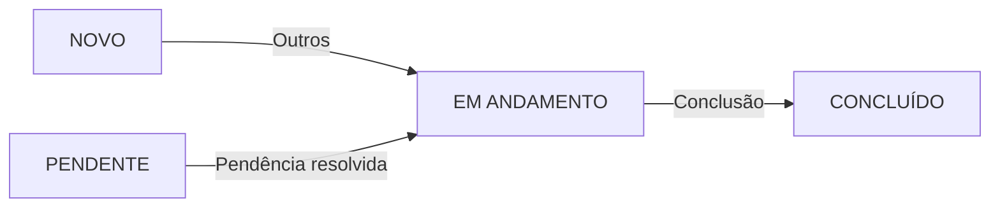
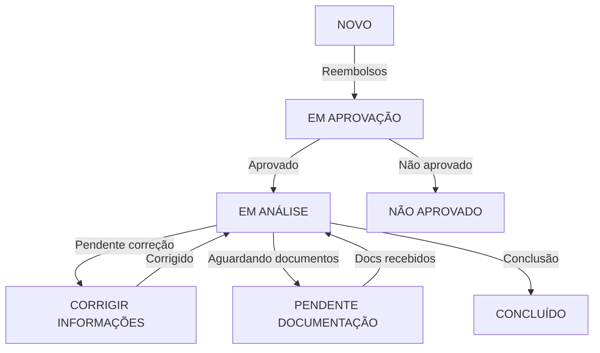

# Workflow Financeiro

> Documentação técnica e funcional de um workflow centralizado de atendimento financeiro, com ramificações determinadas pelo tipo de solicitação informado na abertura do chamado.

## Sumário

- [1. Visão geral](#1-visão-geral)
- [2. Classificação das solicitações](#2-classificação-das-solicitações)
- [3. Governança e aprovação](#3-governança-e-aprovação)
- [4. Regras transversais](#4-regras-transversais)
- [5. Ramificações do workflow](#5-ramificações-do-workflow)
  - [5.1 Outros](#51-outros)
  - [5.2 Reembolsos](#52-reembolsos)
  - [5.3 PG de promotores](#53-pg-de-promotores)
  - [5.4 Pagamentos](#54-pagamentos)
  - [5.5 Faturamento](#55-faturamento)
  - [5.6 Vendas avulsas](#56-vendas-avulsas)
- [6. Estados e transições identificados](#6-estados-e-transições-identificados)
- [7. Considerações de implementação](#7-considerações-de-implementação)

---

## 1. Visão geral

O Workflow Financeiro organiza diferentes tipos de solicitações em um único fluxo centralizado. Na abertura, o demandante seleciona uma modalidade e preenche o formulário correspondente. A modalidade selecionada direciona o chamado para o processo adequado.

O desenho contempla seis modalidades:

1. Outros;
2. Reembolsos;
3. PG de promotores;
4. Pagamentos;
5. Faturamento;
6. Vendas avulsas.

A centralização permite manter uma entrada única para o atendimento financeiro sem obrigar solicitações de naturezas diferentes a seguirem o mesmo procedimento.

### Objetivos operacionais

- Padronizar a entrada das solicitações financeiras.
- Direcionar cada chamado conforme sua natureza.
- Aplicar controles de aprovação quando necessários.
- Registrar etapas de análise, correção, documentação e execução.
- Distinguir decisões orçamentárias de atividades operacionais do Financeiro.

## 2. Classificação das solicitações

Cada modalidade possui um formulário próprio, preenchido pelo demandante na abertura do chamado. O formulário anexado fornece as informações necessárias para identificar a natureza da demanda e orientar o atendimento.

| Modalidade | Finalidade |
|---|---|
| **Outros** | Categoria genérica para dúvidas, pedidos ou procedimentos não contemplados nas demais modalidades. |
| **Reembolsos** | Solicitações de reembolso sujeitas à conferência de valores, comprovantes e elegibilidade orçamentária. |
| **PG de promotores** | Pagamento de promotores avulsos contratados para demandas pontuais da operação, como em uma empresa de eventos. |
| **Pagamentos** | Solicitações de pagamento de diferentes naturezas, com validação orçamentária e preparação bancária. |
| **Faturamento** | Demandas de faturamento que envolvem análise documental e incorporação de valores recebidos ao orçamento disponível. |
| **Vendas avulsas** | Demandas relacionadas a vendas avulsas, com análise documental e atualização do saldo positivo no orçamento. |

## 3. Governança e aprovação

### 3.1 Campo de aprovadores

Os aprovadores são definidos na abertura do chamado por meio de um campo específico. A composição inclui:

- **Aprovadores universais:** participantes definidos pela regra geral de governança financeira.
- **Aprovador gestor do demandante:** gestor relacionado ao setor que originou a solicitação.

A lista de aprovadores pode conter mais pessoas do que o número mínimo de aprovações exigidas.

### 3.2 Quórum configurável

A regra padrão exige duas aprovações. O chamado pode ter mais de dois aprovadores cadastrados, e a quantidade mínima de aprovações pode ser ajustada.

- As duas primeiras interações registradas são consideradas.
- Duas aprovações liberam a solicitação para prosseguir.
- Se houver uma rejeição antes de duas aprovações, a solicitação é considerada rejeitada.
- A rejeição impede que uma aprovação posterior entre no conjunto das duas primeiras interações altere o resultado.

Exemplo da regra padrão:

| Primeiras duas interações | Resultado |
|---|---|
| Aprovação + Aprovação | Aprovado |
| Aprovação + Rejeição | Rejeitado |
| Rejeição + Aprovação | Rejeitado |
| Rejeição + Rejeição | Rejeitado |

> **Nota de implementação:** o número de aprovações exigidas é configurável. A regra descrita acima representa a configuração operacional informada para este processo.

### 3.3 Autoridade para aprovação

A regra geral estabelece como aprovadores autorizados:

- Gestor do Financeiro;
- Membro da Diretoria;
- Gerente do setor do demandante.

A composição efetiva dos aprovadores é registrada no campo próprio da abertura do chamado. A aprovação deve observar a autoridade orçamentária dos participantes.

### 3.4 Reprovação

Quando a solicitação é rejeitada na etapa de aprovação, o chamado segue para o estado de reprovação ou cancelamento previsto para a respectiva ramificação. No fluxo de Reembolsos, o diagrama identifica `NÃO APROVADO`; em outras situações, a regra geral informada prevê cancelamento automático.

## 4. Regras transversais

### 4.1 Estados de pendência e correção

O workflow diferencia situações que exigem ações distintas:

| Estado | Significado operacional |
|---|---|
| `PENDENTE DOCUMENTAÇÃO` | Documentos necessários ainda não foram apresentados pelo demandante. |
| `CORRIGIR INFORMAÇÕES` | Informações ou documentos já foram enviados, mas apresentam inconsistências e precisam ser corrigidos. |
| `PENDENTE CORREÇÃO` | Estado utilizado no fluxo de Pagamentos para aguardar a correção de dados. |
| `CORREÇÃO DE DADOS` | Estado presente no fluxo de Faturamento, associado ao tratamento de dados incorretos. |
| `PENDENTE` | Estado genérico de pendência representado no diagrama, com transição de retorno após resolução da pendência. |

### 4.2 Cores do diagrama

A legenda operacional definida para os workflows é:

- **Cinza:** estado de pendência; pausa o SLA.
- **Azul:** estado de atividade; mantém o SLA em andamento.
- **Verde:** estado de encerramento; encerra o SLA.

As cores representam o comportamento dos estados em relação ao SLA, não apenas sua aparência visual.

### 4.3 Separação de responsabilidades

O processo diferencia atividades de aprovação e execução:

- **Aprovação:** valida a legitimidade da solicitação e sua conformidade com a autoridade orçamentária aplicável.
- **Análise do Financeiro:** confere documentos, dados, valores e requisitos específicos da modalidade.
- **Execução:** realiza a atividade financeira ou operacional correspondente, como programar um pagamento ou atualizar o orçamento.

## 5. Ramificações do workflow

### 5.1 Outros

Categoria genérica para demandas que não se enquadram nas cinco modalidades específicas. Pode incluir desde dúvidas até solicitações de procedimentos não previstos nos demais formulários.

**Entrada e identificação**

- O demandante seleciona `Outros` e preenche o formulário correspondente.
- O formulário anexado identifica a natureza da demanda e orienta o procedimento necessário.

**Tratamento**

- O chamado segue para `EM ANDAMENTO`.
- Esse estado registra o tempo de atuação do atendente do Financeiro na execução da solicitação.
- O atendente realiza o procedimento indicado pelas informações do formulário.

**Encerramento**

- Após a execução do procedimento, o chamado segue para `CONCLUÍDO`.

Fluxo funcional:

### 5.2 Reembolsos

A modalidade de Reembolsos verifica se os valores solicitados são elegíveis e se os documentos apresentados sustentam a solicitação.

**Etapas**

1. `EM APROVAÇÃO`: a solicitação passa pelo mecanismo de aprovação aplicável.
2. `EM ANÁLISE`: o atendente do Financeiro verifica:
   - valores informados;
   - notas fiscais;
   - recibos;
   - compatibilidade da solicitação com o orçamento aprovado.
3. Se houver divergência entre os dados declarados na abertura e os documentos ou informações apresentados, o chamado pode seguir para `CORRIGIR INFORMAÇÕES`.
4. Se os documentos necessários ainda não tiverem sido enviados, o chamado pode seguir para `PENDENTE DOCUMENTAÇÃO`.
5. Com os documentos recebidos ou as informações corrigidas, o fluxo retorna para `EM ANÁLISE`.
6. Estando a análise concluída, o chamado segue para `CONCLUÍDO`.

**Distinção entre pendências**

- `PENDENTE DOCUMENTAÇÃO`: aguarda documentos que ainda não foram enviados.
- `CORRIGIR INFORMAÇÕES`: aguarda correção de dados ou documentos já enviados, mas inconsistentes.

**Reprovação**

O diagrama identifica a transição de `EM APROVAÇÃO` para `NÃO APROVADO` quando a solicitação não é aprovada.

Fluxo funcional:

### 5.3 PG de promotores

Modalidade destinada ao pagamento de promotores avulsos contratados para demandas pontuais da operação, como ocorre em uma empresa de eventos.

**1. EM APROVAÇÃO**

O gestor responsável pela demanda valida o valor do pagamento e a identificação do recebedor. A aprovação utiliza a regra geral de aprovadores configurados no campo próprio do chamado, com quórum aplicável.

**2. EM ANÁLISE**

Após a aprovação, o Financeiro verifica:

- dados e documentação dos promotores que receberão os valores;
- informações de pagamento;
- alinhamento entre os dados apresentados e o projeto correspondente.

**Tratamento de divergências**

| Tipo de divergência | Encaminhamento |
|---|---|
| Documentos necessários ainda não enviados | `PENDENTE DOCUMENTAÇÃO` |
| Dados ou documentos enviados, mas inconsistentes | `CORRIGIR INFORMAÇÕES` |
| Divergência grave que comprometa a solicitação | `CANCELADO` |

**3. Conclusão**

Estando as informações corretas, o pagamento é liberado e o chamado segue para `CONCLUÍDO`.

A aprovação do gestor e a análise do Financeiro são controles distintos: a primeira valida o valor e o recebedor; a segunda confere a documentação e a consistência das informações de pagamento com o projeto.

### 5.4 Pagamentos

Modalidade destinada a solicitações de pagamentos de diferentes naturezas.

**Aprovação**

A etapa de aprovação verifica:

- se existe previsão de pagamento para a conta em questão;
- se o valor solicitado está de acordo com o orçamento previsto para o período.

Em caso de negativa, o chamado é cancelado.

**Análise e preparação bancária**

Após a aprovação, o Financeiro realiza os trâmites necessários para manipulação das contas bancárias e programação do pagamento.

**Irregularidades**

Se houver irregularidade durante o tratamento, o chamado pode ser direcionado para `PENDENTE DOCUMENTAÇÃO`.

**Conclusão**

Após a programação do pagamento, o chamado segue diretamente para `CONCLUÍDO`, sem uma etapa intermediária de acompanhamento da efetivação.

> O diagrama apresenta o estado `NF RECEPCIONADA`, o estado `PENDENTE CORREÇÃO` e o resultado `PAGAMENTO PROGRAMADO` nesta ramificação. A descrição funcional acima registra as regras operacionais esclarecidas para a modalidade.

### 5.5 Faturamento

A modalidade de Faturamento envolve análise documental e atualização do orçamento da empresa.

**EM ANÁLISE / EM FATURAMENTO**

- Conferência da documentação relacionada à solicitação.
- Validação dos valores envolvidos.
- Inclusão do saldo positivo no orçamento disponível da empresa, representando valores recebidos.

**Correção**

O diagrama identifica os estados `CORREÇÃO DE DADOS` e `EM FATURAMENTO`, conectados por transições identificadas como `Faturamento`.

**Conclusão**

Após a análise documental e a inclusão do saldo positivo no orçamento, o processo segue para `NF FATURADA`.

### 5.6 Vendas avulsas

A modalidade de Vendas avulsas possui comportamento semelhante ao Faturamento quanto à análise documental e à inclusão do saldo positivo no orçamento da empresa. O diagrama, entretanto, apresenta etapas operacionais específicas para essa modalidade.

**Etapas identificadas no diagrama**

- `EM ATENDIMENTO`;
- `PENDENTE FLYSHEET`;
- `PENDENTE PAGAMENTO`;
- `PAGAMENTO CONFIRMADO`;
- `VENDA NÃO IDENTIFICADA`;
- `VENDA CONFIRMADA`.

O fluxo visual associa a modalidade a etapas de identificação e confirmação de pagamento. Também apresenta a transição `Confirmado Maracanã` entre `PAGAMENTO CONFIRMADO` e `VENDA CONFIRMADA`.

**Regra funcional confirmada**

Assim como em Faturamento, a análise envolve documentação e inclusão do saldo positivo no orçamento disponível da empresa.

> Os nomes dos estados e transições acima foram preservados conforme o diagrama. A sequência e os critérios detalhados de cada etapa de Vendas avulsas não foram integralmente especificados no levantamento funcional; por isso, não são presumidas regras adicionais.

## 6. Estados e transições identificados

A tabela consolida os nomes visíveis no diagrama. A classificação por cor segue a legenda operacional informada para os workflows.

| Estado | Classificação no diagrama |
|---|---|
| `NOVO` | Entrada |
| `EM ANDAMENTO` | Atividade |
| `EM APROVAÇÃO` | Aprovação |
| `EM ANÁLISE` | Atividade |
| `NÃO APROVADO` | Encerramento |
| `CONCLUÍDO` | Encerramento |
| `PENDENTE` | Pendência |
| `CORRIGIR INFORMAÇÕES` | Pendência |
| `PENDENTE DOCUMENTAÇÃO` | Pendência |
| `NF RECEPCIONADA` | Atividade |
| `PENDENTE CORREÇÃO` | Pendência |
| `PAGAMENTO PROGRAMADO` | Encerramento da etapa de pagamento |
| `CORREÇÃO DE DADOS` | Pendência/correção |
| `EM FATURAMENTO` | Atividade |
| `NF FATURADA` | Encerramento |
| `PENDENTE FLYSHEET` | Pendência |
| `EM ATENDIMENTO` | Atividade |
| `PENDENTE PAGAMENTO` | Pendência |
| `PAGAMENTO CONFIRMADO` | Atividade |
| `VENDA NÃO IDENTIFICADA` | Pendência/tratamento |
| `VENDA CONFIRMADA` | Encerramento |
| `CANCELADO` | Encerramento |
| `NF CANCELADA` | Encerramento |

### Transições e rótulos relevantes

O diagrama apresenta, entre outros, os seguintes rótulos de transição:

- `Outros`
- `Reembolsos`
- `PG de promotores`
- `Pagamentos`
- `Faturamento`
- `Vendas Avulsas`
- `Aprovado`
- `Não aprovado`
- `Docs recebidos`
- `Aguardando docs`
- `Pendente correção`
- `Corrigido`
- `Corrigir dados`
- `Dados corrigidos`
- `Conclusão`
- `Faturado`
- `Pagamento identificado`
- `Pg não identificado`
- `Confirmado Maracanã`
- `Tudo`

O rótulo `Tudo` aparece associado a transições para estados de encerramento, como `CANCELADO` e `NF CANCELADA`.

## 7. Considerações de implementação

### 7.1 Formulários como mecanismo de roteamento

A escolha da modalidade e o formulário correspondente são fundamentais para identificar a natureza da solicitação e orientar o processo. A documentação deve considerar o formulário como parte da lógica de entrada, e não apenas como anexo informativo.

### 7.2 Aprovação configurável

O campo de aprovadores permite compor a lista de responsáveis por solicitação. O quórum mínimo configurável permite ajustar a quantidade de aprovações exigidas sem depender de uma lista fixa de aprovadores.

### 7.3 Controles em camadas

O workflow separa:

- autorização da solicitação;
- validação documental e financeira;
- execução do procedimento;
- conclusão ou cancelamento.

Essa separação melhora a rastreabilidade e deixa mais claro o papel de cada participante.

### 7.4 Tratamento de exceções

Os estados de pendência e correção permitem devolver solicitações para regularização sem confundir ausência de documentos com inconsistência de informações. O cancelamento é utilizado quando a solicitação é rejeitada ou quando há divergência grave que inviabilize seu prosseguimento.

---

**Escopo desta documentação:** regras e comportamentos esclarecidos durante o levantamento funcional, combinados com os estados e rótulos identificados no diagrama fornecido. Onde a sequência detalhada ou a condição de uma transição não foi confirmada, o documento preserva o que está visível e evita inferir uma regra não validada.
