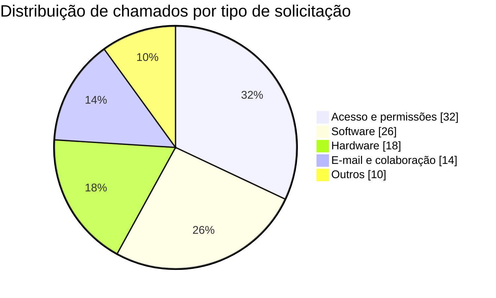

# KPI — Distribuição das Solicitações

## Objetivo

Visualizar a distribuição do volume de chamados por tipo de solicitação, identificando as categorias de maior demanda e apoiando decisões sobre capacidade, priorização e prevenção de incidentes recorrentes.

## JQL — Base do indicador

```jql
project = XXX
AND created >= -90d
ORDER BY created DESC
```

**Propósito:** selecionar os chamados criados no projeto dentro dos últimos 90 dias. A classificação por categoria é realizada pelo gadget do dashboard, utilizando o campo **Tipo de solicitação**.

> Substitua `XXX` pelo identificador do projeto e ajuste o período conforme a janela de análise. O campo de agrupamento deve corresponder ao campo efetivamente utilizado no Jira; em ambientes JSM, o nome interno do campo pode variar.

## Visualização simulada

Exemplo ilustrativo de distribuição por tipo de solicitação. Os valores abaixo são fictícios e servem apenas para demonstrar a apresentação do indicador.



## Configuração do dashboard

| Propriedade | Configuração |
|---|---|
| Gadget sugerido | Pie Chart |
| Filtro | JQL — Base do indicador |
| Estatística / agrupamento | Tipo de solicitação |
| Visualização | Gráfico de rosca ou pizza |
| Período | Últimos 90 dias (ajustável) |

## Leitura gerencial

- Identificar os tipos de solicitação com maior participação no volume total.
- Detectar concentração de chamados em categorias específicas.
- Apoiar decisões de treinamento, documentação, automação e prevenção de incidentes.

## Variação — Distribuição da carga por atendente

O mesmo conjunto de chamados pode ser analisado por responsável, substituindo o agrupamento do gadget de **Tipo de solicitação** para **Responsável (Assignee)**.

**JQL — Base para carga por atendente**

```jql
project = XXX
AND created >= -90d
AND assignee is not EMPTY
ORDER BY created DESC
```

**Propósito:** selecionar chamados atribuídos dentro do período, permitindo visualizar a distribuição do volume entre os atendentes.

| Propriedade | Configuração |
|---|---|
| Gadget sugerido | Pie Chart ou Two Dimensional Filter Statistics |
| Filtro | JQL — Base para carga por atendente |
| Estatística / agrupamento | Responsável (Assignee) |
| Métrica | Quantidade de chamados atribuídos |

> **Limitação de interpretação:** a quantidade de chamados atribuídos é um indicador de distribuição de volume, não uma medida completa de esforço ou produtividade. Para avaliar carga de trabalho, considere também complexidade, tempo investido, reatribuições e chamados ainda em andamento.
